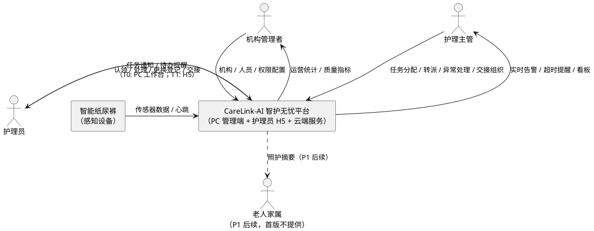
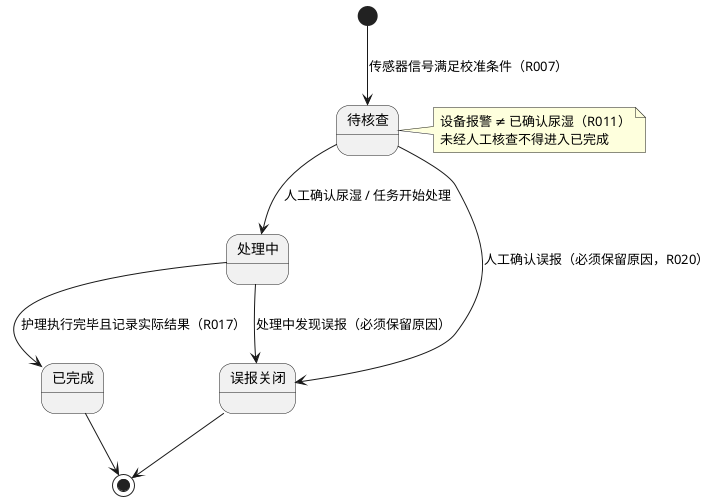
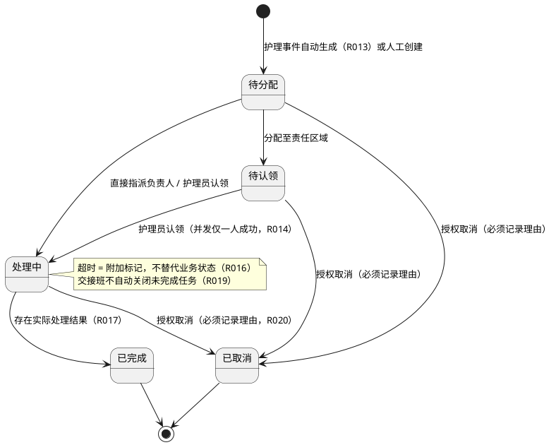

# CareLink-AI 智护无忧 基准需求规格说明书（SPEC）

| 属性 | 内容 |
|------|------|
| 产品名称 | CareLink-AI 智护无忧（AIoT 老年智能照护管理平台） |
| 文档版本 | V1.0（基准版） |
| 编写日期 | 2026-11-24 |
| 文档状态 | 待评审 |
| 需求格式 | EARS（Easy Approach to Requirements Syntax） |
| 首版范围 | 竞赛 MVP：全部 P0 功能 + 提前实现的 P1 功能（AI 交接班摘要、个体规律分析） |
| 阶段规划 | T0：PC Web 管理端（Vue3 + 后端 API）；T1：护理员 H5 移动端 |
| 部署环境 | 华为云（CodeArts + RDS + Redis + ECS） |

---

## 0. 文档约定

### 0.1 EARS 语法约定

本文件功能需求采用 EARS 格式，使用以下五种句式：

| 模式 | 句式 | 适用场景 |
|------|------|----------|
| 无条件式 | 系统应 `<响应>`。 | 普遍存在的能力 |
| 事件驱动式 | 当 `<触发条件>` 时，系统应 `<响应>`。 | 外部事件触发的行为 |
| 状态驱动式 | 在 `<状态>` 期间，系统应 `<响应>`。 | 持续状态下的约束 |
| 可选特征式 | 在 `<启用特征>` 的场景中，系统应 `<响应>`。 | 条件启用的能力 |
| 非期望行为式 | 如果 `<条件>`，则系统应 `<响应>`。 | 异常与防护行为 |

### 0.2 优先级定义

| 标识 | 定义 |
|------|------|
| P0 | 竞赛首版必须实现的核心功能 |
| P1-E | 原 P1 差异化增强功能，首版提前实现（仅限：AI 交接班摘要、个体规律分析） |
| P1 | 差异化增强功能，首版之后实现 |
| P2 | 商业化扩展功能，不在当前规划内 |

### 0.3 阶段定义

| 阶段 | 交付物 | 覆盖角色视角 |
|------|--------|--------------|
| T0 | PC Web 管理端（Vue3 前端 + 后端 API）+ 华为云部署 | 护理主管、机构管理者；护理员相关操作（认领、处理、更换登记、交接）在 PC 端"护理工作台"中可执行 |
| T1 | 护理员 H5 移动端（复用 T0 后端 API 与业务规则） | 护理员执行视角 |

### 0.4 编号规则

- 功能需求：`FR-<模块缩写>-<三位序号>`（模块缩写：ORG/ELD/DEV/EVT/TSK/REC/AI/OPS/SEC/H5）
- 业务规则：`R<三位序号>`（沿用 PRD R001–R027，编号不变）
- 非功能需求：`NFR-<三位序号>`
- 验收标准：`AC<两位序号>`（沿用 PRD AC01–AC14，编号不变）

### 0.5 前置假设与待确认事项

依据 PRD 第十六节，以下硬件接口能力均为**待确认事项，不作既定事实**：检测维度（尿湿/排便）、湿润程度识别、液体量估算、数据上传频率、通信方式（蓝牙/Wi-Fi）、独立设备编号、电量读取、更换后重置方式、断网期间数据保存、传感器准确性实验结果。

本 SPEC 的处理原则：

1. 首版以"设备模拟器 + 统一设备接入接口"保障软件开发不阻塞于硬件确认进度；
2. 监测状态分级与事件触发阈值以"可配置规则"实现，硬件能力确认后按实验校准结果调整（R007）；
3. 凡涉及硬件能力的条款，均以"经校准 / 以硬件实际能力为准"表述，不虚构硬件能力。

---

## 1. 系统概述与用户角色

### 1.1 系统概述

**一句话定位**：以智能纸尿裤为感知入口，以老年失禁照护为核心场景，将实时感知、护理任务、人员协作、个体化照护分析和机构管理连接起来，实现从被动人工巡查向主动智能照护的转变。

**产品形态**：智能纸尿裤硬件 + 云端照护管理平台 + PC 管理端 + 护理员移动端 H5。

**职责分工**：硬件负责发现问题，软件负责组织解决问题，AI 负责辅助理解问题和改善照护方式。

**核心业务主线**：发现需求 → 组织处理 → 沉淀数据 → 改善下一次护理。

**三大业务闭环**：

| 闭环 | 链路 | 价值 |
|------|------|------|
| 即时护理闭环 | 设备发现异常 → 人工确认并完成护理 | 及时性 |
| 个体照护闭环 | 历史护理记录 → 优化个人照护安排 | 个体化 |
| 机构管理闭环 | 全部护理过程数据 → 管理者调整人员及资源 | 规模化 |

**四类核心数据的严格区分**（贯穿全系统）：传感器数据（设备实际上传）、护理事件（系统识别的待处理事项）、护理任务（安排的人工工作）、护理记录（人员实际执行产生的事实）。传感器发出十次信号不代表排尿十次；创建任务不代表护理已完成。

### 1.2 用户角色

| 角色 | 定位 | 核心诉求 | 首版交互入口 |
|------|------|----------|--------------|
| 护理员 | 核心执行者：查看任务、到场检查、更换纸尿裤、记录结果 | 减少无效巡查，明确当前应该做什么 | T0：PC 端护理工作台；T1：H5（今日待办/在护老人/任务处理/交接班/我的） |
| 护理主管 | 核心调度者：分配任务、处理异常、监督完成情况、组织交接班 | 确保任务有人处理，避免护理遗漏 | T0：PC 管理端（主视角） |
| 机构管理者 | 核心购买决策者：运营、人员管理、耗材管理、护理质量监督 | 了解人力效率、照护质量和运营成本 | T0：PC 管理端（主视角） |
| 老人及家属 | 服务受益者：及时照护、安全感、服务透明度 | 获得及时照护与信息透明 | 老人为被照护对象；家属服务（M10）为 P1，首版不提供家属端 |

### 1.3 阶段划分与首版功能映射

**首版 MVP 六项业务**：

1. 建立照护对象：创建机构、老人、床位、护理员并绑定设备；
2. 实时感知：接入真实或明确标记的模拟设备数据；
3. 主动发现护理需求：识别尿湿相关事件，自动生成护理任务；
4. 完成护理闭环：护理员接单、确认、更换、记录结果；
5. 智能照护分析：历史规律分析 + AI 交接班摘要（两项 P1-E 提前实现，作为智能化展示重点）；
6. 华为云部署：实际使用 CodeArts、Skills、RDS、Redis 完成云端交付。

**T0 阶段 PC 管理端一级页面映射**：

| PC 一级页面 | 承载功能模块 | 主视角 |
|-------------|--------------|---------|
| 照护总览 | 机构实时看板（M08-01）、实时告警 | 护理主管/机构管理者 |
| 护理工作台 | 事件中心（M04）、任务分配与处理（M05）、交接班（M06） | 护理主管（护理员操作可执行） |
| 老人档案 | 老人档案（M02）、护理时间线 | 护理主管/机构管理者 |
| 智能照护 | 个体规律分析（M07-01~06）、AI 交接班摘要（M06-07） | 护理主管/机构管理者 |
| 设备中心 | 设备注册/绑定/在线状态/历史数据/模拟器（M03） | 护理主管/机构管理者 |
| 运营管理 | 事件处理统计、响应时长、完成率（M08-02~04） | 机构管理者 |
| 系统设置 | 机构与人员管理、角色权限、规则、审计日志（M01、M11） | 机构管理者 |

**T1 阶段护理员 H5 页面映射**：今日待办、在护老人、任务处理、交接班、我的（详见 2.10）。

**设计原则**：事找人，而不是人找事。

### 1.4 职责边界（首版不做什么）

以下事项明确划出首版范围：

1. 完整养老院收费管理、入住合同管理；
2. 复杂智能排班算法（M01-05 排班管理为 P1）；
3. 完整采购供应链、耗材管理全模块（M09 为 P1）、消耗趋势分析与采购建议（P2）；
4. 疾病诊断与医疗决策、精确排尿时间预测（M07-08 为 P2）；
5. 多种设备全部接入（首版仅预留统一设备接入接口，M03-08 为 P2）；
6. 家属端服务（M10 授权绑定、照护摘要、通知为 P1；沟通反馈为 P2）；
7. 自然语言查询（M07-07 为 P2）、多区域对比（M08-08 为 P2）、多机构管理（M01-06 为 P2）；
8. 事件规则配置（M04-08）、事件趋势分析（M04-09）、智能调度建议（M05-10）、交接确认（M06-08）、个人照护计划维护（M02-05）、家属授权管理（M02-06）、护理人员工作量/护理质量分析/运营报告（M08-05~07）、数据留存管理（M11-08）均为 P1，首版不实现。

### 1.5 领域术语

**传感器数据（SensorReading）**
: 设备实际上传的原始监测数据，包含设备标识、采集时间、接收时间、监测值与数据质量；仅代表设备读数，不代表护理事实。

**护理事件（CareEvent）**
: 系统依据经校准规则从传感器数据中识别出的"待核查/待处理事项"，必须保留触发依据、时间与关联设备。

**护理任务（CareTask）**
: 由护理事件自动生成或人工创建的、安排给护理人员执行的工作，具有负责人、优先级、处理时限与状态。

**护理记录（CareRecord）**
: 护理人员实际执行护理后产生的事实记录，包含执行人员、时间、护理结果与耗材消耗。

**护理周期**
: 从纸尿裤更换（或设备重新佩戴/有效状态确认）建立，到下一次更换为止的时间区间；同一周期内的重复尿湿信号合并处理。

**待核查**
: 护理事件的初始状态；设备报警不等于已确认尿湿，必须经人工反馈确认（R011）。

**误报**
: 经人工到场确认后判定为设备错误报警的事件结果；误报关闭必须保留原因（R020）。

**个人基线**
: 基于老人有效历史数据形成的个人参考范围（如各时段尿湿频率），用于识别异常偏离。

**AI 交接班摘要**
: 基于当班真实记录、未完成任务与设备异常，由 AI 生成的结构化交接内容；内容必须与数据库真实记录一致且可追溯。

**设备绑定（DeviceBinding）**
: 老人与监测设备之间的关联关系，带生效起止时间；同一设备同一时间只能绑定一位老人（R001）。

**在护老人**
: 已入住并关联床位、处于照护状态的老人。

**超时标记**
: 任务超过规定时限未处理时附加的标记；超时是附加标记，不替代任务业务状态（R016）。

### 1.6 交互上下文

---

## 2. 功能需求（EARS 格式）

> 条目格式：**FR-编号**（优先级｜阶段｜PRD 功能项）：EARS 语句。（关联规则/验收标准）

### 2.1 机构与人员管理（FR-ORG｜M01｜P0｜T0）

覆盖：M01-01 机构管理、M01-02 区域与床位管理、M01-03 护理人员管理、M01-04 角色权限管理。后续范围：M01-05 排班管理（P1）、M01-06 多机构管理（P2）。

- **FR-ORG-001**（P0｜T0｜M01-01）：系统应支持创建、编辑、启用、停用养老机构，并维护机构名称、地址、联系方式等基本信息。
- **FR-ORG-002**（P0｜T0｜M01-02）：系统应支持维护"楼栋—楼层—房间—床位"四级层级关系，且每个床位应唯一归属一个房间。
- **FR-ORG-003**（P0｜T0｜M01-02）：当床位被在护老人占用时，系统应将床位状态展示为"在护"并关联该老人。
- **FR-ORG-004**（P0｜T0｜M01-03）：系统应支持维护护理人员（护理员、护理主管、机构管理者）的姓名、联系方式、所属角色与在岗状态。
- **FR-ORG-005**（P0｜T0｜M01-03）：当护理人员被标记为离岗时，系统应停止向其分配新任务，并保留其历史护理记录。
- **FR-ORG-006**（P0｜T0｜M01-04）：系统应按角色控制功能页面与数据的可见范围及可执行操作。
- **FR-ORG-007**（P0｜T0｜M01-04）：如果用户尝试执行超出其角色权限的操作，则系统应拒绝该操作并提示无权限。（AC12）

### 2.2 老人照护档案（FR-ELD｜M02｜P0｜T0）

覆盖：M02-01 老人基本档案、M02-02 护理需求档案、M02-03 设备绑定、M02-04 护理时间线。后续范围：M02-05 个人照护计划（P1）、M02-06 家属授权管理（P1）。

- **FR-ELD-001**（P0｜T0｜M02-01）：系统应支持维护老人基本信息（姓名、性别、年龄等）及所在床位，且每位老人在同一时间应关联至多一个在用床位。
- **FR-ELD-002**（P0｜T0｜M02-02）：系统应支持记录老人的护理等级、行动能力及照护要求。
- **FR-ELD-003**（P0｜T0｜M02-03）：系统应支持建立老人与监测设备之间的绑定关系，并遵循 R001–R003。
- **FR-ELD-004**（P0｜T0｜M02-03）：当设备与老人解绑或换绑时，系统应保留历史绑定记录及绑定期间产生的全部照护数据。（R003）
- **FR-ELD-005**（P0｜T0｜M02-04）：系统应支持以时间线形式查看老人的护理事件、护理任务与护理记录及其关联关系。
- **FR-ELD-006**（P0｜T0｜M02-04）：如果用户访问超出其机构或授权范围的老人档案，则系统应拒绝访问并记录审计日志。（AC12）

### 2.3 智能设备与数据接入（FR-DEV｜M03｜P0｜T0）

覆盖：M03-01 设备注册、M03-02 传感器数据接收、M03-03 实时状态监测、M03-04 设备在线检测、M03-05 设备故障提醒、M03-06 历史数据查询、M03-07 设备模拟器。后续范围：M03-08 多类型设备适配（P2，首版仅预留统一接口）。

- **FR-DEV-001**（P0｜T0｜M03-01）：系统应支持注册监测设备，维护设备编号、设备类型与通信信息，且设备编号应全局唯一。
- **FR-DEV-002**（P0｜T0｜M03-02）：系统应提供设备数据接入接口，接收并保存设备上传的传感器数据（设备标识、采集时间、接收时间、监测值、数据质量）。
- **FR-DEV-003**（P0｜T0｜M11-04）：当设备通过接入接口上报数据时，系统应校验设备身份；如果设备未通过认证，则系统应拒绝接收其数据。
- **FR-DEV-004**（P0｜T0｜M03-03）：系统应展示每台设备最新有效监测状态及最后通信时间。
- **FR-DEV-005**（P0｜T0｜M03-04）：当设备超过配置时限未上传心跳或数据时，系统应将其标记为"离线"。
- **FR-DEV-006**（P0｜T0｜M03-05）：当设备离线时，系统应生成设备异常提醒并提示人工检查，且不得将关联老人状态展示为"正常/干燥"。（R005，AC07）
- **FR-DEV-007**（P0｜T0｜M03-05）：系统应识别低电量与无效数据，并生成对应的设备异常提醒。
- **FR-DEV-008**（P0｜T0｜M03-06）：系统应支持按设备与时间范围查询历史监测数据。
- **FR-DEV-009**（P0｜T0｜M03-07）：系统应提供设备模拟器，支持创建明确标记为"模拟"的虚拟设备并生成模拟事件。（R006）
- **FR-DEV-010**（P0｜T0｜M03-07）：当模拟设备上报数据时，系统应对数据打上"模拟"标记，并在存储与展示上与真实设备数据明确区分。（R006）
- **FR-DEV-011**（P0｜T0｜M03-08 预留）：系统应提供统一设备接入模型，使新增设备类型时无需修改核心业务逻辑。（NFR-010）

### 2.4 智能护理事件中心（FR-EVT｜M04｜P0｜T0）

覆盖：M04-01 尿湿事件识别、M04-02 状态分级、M04-03 重复事件过滤、M04-04 事件优先级、M04-05 实时事件通知、M04-06 事件历史查询、M04-07 误报反馈。后续范围：M04-08 事件规则配置（P1）、M04-09 事件趋势分析（P1）。

- **FR-EVT-001**（P0｜T0｜M04-01）：当传感器数据满足经实验校准的触发条件时，系统应生成一条状态为"待核查"的尿湿护理事件。（R007，AC02）
- **FR-EVT-002**（P0｜T0｜M04-01）：如果传感器信号未满足触发条件，则系统应仅更新实时监测状态，不生成护理事件与护理任务。（AC01）
- **FR-EVT-003**（P0｜T0｜M04-02）：系统应支持按硬件实际感知能力配置监测状态分级；在硬件能力确认前，首版应至少区分"正常/干燥、待核查（疑似尿湿）、离线/数据无效"三类展示状态。
- **FR-EVT-004**（P0｜T0｜M04-03）：当同一护理周期内出现重复尿湿信号时，系统应将其合并至同一未处理事件，不生成新事件。（R008，AC03）
- **FR-EVT-005**（P0｜T0｜M04-04）：系统应按等待时长、老人护理需求等级等规则对待核查事件排序展示。
- **FR-EVT-006**（P0｜T0｜M04-05）：当护理事件生成时，系统应在 3 秒内向责任区域护理人员及相关管理者推送实时通知。（NFR-001）
- **FR-EVT-007**（P0｜T0｜M04-06）：系统应支持查询事件历史，包括触发依据、状态变化轨迹与处理结果。（R010）
- **FR-EVT-008**（P0｜T0｜M04-07）：当护理人员确认事件为误报时，系统应将事件关闭为"误报关闭"并保留误报原因。（R011、R020，AC06）
- **FR-EVT-009**（P0｜T0｜M04）：系统应将尿湿事件与设备故障事件区分为不同事件类型，不得混淆处理。（R009）
- **FR-EVT-010**（P0｜T0｜M04-01）：在人工到场确认前，系统应将设备报警事件保持在"待核查"状态，不得将其视为已确认的尿湿事实。（R011）
- **FR-EVT-011**（P0｜T0｜M04-01）：当未绑定老人的设备数据满足触发条件时，系统应生成设备级待核查事项，且不得直接生成针对老人的护理事件或护理任务。（R004）

### 2.5 护理任务与协同（FR-TSK｜M05｜P0｜T0，认领/处理同时映射 T1）

覆盖：M05-01 自动生成任务、M05-02 任务分配、M05-03 任务认领、M05-04 任务优先排序、M05-05 任务处理、M05-06 超时提醒、M05-07 任务转派、M05-08 异常任务处理、M05-09 主动创建任务。后续范围：M05-10 智能调度建议（P1）。

- **FR-TSK-001**（P0｜T0｜M05-01）：当有效护理事件生成时，系统应自动生成一条关联的护理任务，初始状态为"待分配/待认领"。（R013）
- **FR-TSK-002**（P0｜T0｜M05-01）：当同一护理事件重复触发时，系统不得生成多个有效的同类护理任务。（R013，AC03）
- **FR-TSK-003**（P0｜T0｜M05-02）：系统应支持护理主管将任务分配给指定护理员或责任区域。
- **FR-TSK-004**（P0｜T0/T1｜M05-03）：系统应支持护理员认领任务；当多名护理员同时认领同一任务时，系统应保证仅一人认领成功，并向未成功方提示任务已被认领。（R014，AC04）
- **FR-TSK-005**（P0｜T0｜M05-04）：系统应按护理需求等级、处理时限及已等待时长对任务排序。
- **FR-TSK-006**（P0｜T0/T1｜M05-05）：系统应支持记录任务处理过程，包括到场确认、检查结果确认与护理操作执行。
- **FR-TSK-007**（P0｜T0｜M05-06）：当任务超过规定时限仍未处理时，系统应触发超时提醒，并为任务附加"超时"标记，且不得改变任务业务状态或自动标记完成。（R016，AC08）
- **FR-TSK-008**（P0｜T0｜M05-07）：系统应支持授权人员转派任务，并记录原负责人、新负责人与转派原因。（R018）
- **FR-TSK-009**（P0｜T0｜M05-08）：系统应支持处理异常任务（护理员拒绝护理、设备误报等场景），且处理时必须保留处理理由。（R020）
- **FR-TSK-010**（P0｜T0｜M05-09）：系统应支持人工主动创建检查类或临时护理类任务。
- **FR-TSK-011**（P0｜T0｜M05-05）：当任务被标记完成时，系统应要求存在实际处理结果；如果无实际处理结果，则系统应拒绝完成操作。（R017）
- **FR-TSK-012**（P0｜T0｜M05）：未完成任务应持续保留在待办范围内，系统不得因交接班而自动关闭。（R015、R019）
- **FR-TSK-013**（P0｜T0｜M05）：同一任务在同一时间应只有一位主要负责人。（R014）

### 2.6 护理记录与交接班（FR-REC｜M06｜P0 + P1-E｜T0）

覆盖：M06-01 护理结果记录、M06-02 快捷更换登记、M06-03 护理异常记录、M06-04 护理记录自动关联、M06-05 历史护理查询、M06-06 未完成任务交接、M06-07 AI 交接班摘要（P1-E 提前实现）。后续范围：M06-08 交接确认（P1）。

- **FR-REC-001**（P0｜T0｜M06-01）：系统应支持记录护理结果，包括执行人员、执行时间与实际护理结果。
- **FR-REC-002**（P0｜T0/T1｜M06-02）：系统应支持快捷更换登记，且常规护理完成登记应控制在 3 次主要操作内。（NFR-006）
- **FR-REC-003**（P0｜T0/T1｜M06-03）：系统应支持记录护理异常情况（如皮肤状态异常、需进一步处理等）。
- **FR-REC-004**（P0｜T0｜M06-04）：当护理记录生成时，系统应自动关联老人、护理事件、护理任务与设备。（AC05）
- **FR-REC-005**（P0｜T0｜M06-05）：系统应支持按老人、执行人员及时间范围查询历史护理记录。
- **FR-REC-006**（P0｜T0｜M06-06）：系统应支持交接班时将未完成任务移交给下一班责任人员，并保留移交轨迹。（AC09）
- **FR-REC-007**（P0｜T0｜M06-06）：在交接班过程中，系统不得自动关闭或取消未完成任务。（R019）
- **FR-REC-008**（P1-E｜T0｜M06-07）：系统应支持基于当班真实护理记录、未完成任务与设备异常，生成结构化 AI 交接班摘要。
- **FR-REC-009**（P1-E｜T0｜M06-07）：当生成 AI 交接班摘要时，系统应保证摘要内容与数据库真实记录一致，并标注所依据的数据范围与时间范围。（R021、R026，AC10）
- **FR-REC-010**（P1-E｜T0｜M06-07）：如果当班数据不足，则系统应在 AI 摘要中明确说明数据不足，不得虚构护理内容。（R022）

### 2.7 个体化照护与 AI 分析（FR-AI｜M07｜P1-E｜T0，首版提前实现）

覆盖（首版提前实现）：M07-01 尿湿事件规律、M07-02 更换频率分析、M07-03 个人基线建立、M07-04 异常变化提示、M07-05 检查时机建议、M07-06 AI 照护报告。后续范围：M07-07 自然语言查询（P2）、M07-08 个体预测模型（P2）。

- **FR-AI-001**（P1-E｜T0｜M07-01）：系统应支持分析老人个人尿湿事件的时段分布规律，并可视化展示。
- **FR-AI-002**（P1-E｜T0｜M07-02）：系统应支持统计个人纸尿裤使用量与更换间隔。
- **FR-AI-003**（P1-E｜T0｜M07-03）：系统应基于有效历史数据建立个人参考基线（如各时段尿湿频率的参考范围）。
- **FR-AI-004**（P1-E｜T0｜M07-04）：当老人近期表现与个人基线明显偏离时，系统应生成异常变化提示。
- **FR-AI-005**（P1-E｜T0｜M07-05）：系统应基于个人历史规律与护理计划，输出建议检查时段及其依据。
- **FR-AI-006**（P1-E｜T0｜M07-06）：系统应支持生成可追溯的个人照护摘要报告（AI 照护报告），并标注数据来源与时间范围。（R026）
- **FR-AI-007**（P1-E｜T0｜M07）：如果有效历史数据不足，则系统应明确提示"数据不足"，不得生成虚假规律或基线。（R022，AC11）
- **FR-AI-008**（P1-E｜T0｜M07）：当设备离线导致监测数据缺失时，系统应在分析结果中将该时段标注为"监测缺失"，不得解释为"无排泄事件"。（R023）
- **FR-AI-009**（P1-E｜T0｜M07）：系统应将 AI 生成的护理建议标记为"辅助建议"，不得自动替代护理人员判断或自动调整照护计划。（R024）
- **FR-AI-010**（P1-E｜T0｜M07）：系统不得以 AI 预测结果为理由取消或缩短必要的人工检查任务。（R027）
- **FR-AI-011**（P1-E｜T0｜M07）：AI 输出不得包含基于未经验证传感器数据的疾病诊断性结论。（R025）
- **FR-AI-012**（P1-E｜T0｜M07）：系统应区分确定性规则、统计分析与 AI 生成内容的职责边界：能用确定性程序完成的判断（离线判定、触发判定、事件去重、任务状态流转、响应时长与完成率计算）不得交给大语言模型处理。

### 2.8 机构运营与护理质量（FR-OPS｜M08｜P0｜T0）

覆盖：M08-01 机构实时看板、M08-02 事件处理统计、M08-03 护理响应时长、M08-04 护理完成率。后续范围：M08-05 护理人员工作量（P1）、M08-06 护理质量分析（P1）、M08-07 运营报告生成（P1）、M08-08 多区域对比（P2）。

- **FR-OPS-001**（P0｜T0｜M08-01）：系统应提供机构实时看板，展示在护老人数、在线设备数、待处理任务数、超时任务数、床位状态分布与实时告警。
- **FR-OPS-002**（P0｜T0｜M08-02）：系统应统计事件处理情况，包括待处理、已处理、超时事件的数量及占比。
- **FR-OPS-003**（P0｜T0｜M08-03）：系统应统计护理响应时长（事件发生至护理响应的时间间隔）及其分布。
- **FR-OPS-004**（P0｜T0｜M08-04）：系统应统计有效护理任务的完成率。
- **FR-OPS-005**（P0｜T0｜M08）：运营统计指标应基于真实护理过程数据（事件、任务、记录）计算，并支持按数据来源（真实/模拟）标识或筛选展示。（R006）

### 2.9 系统安全与运行保障（FR-SEC｜M11｜P0｜T0）

覆盖：M11-01 登录身份认证、M11-02 业务数据访问控制、M11-03 操作审计日志、M11-04 设备接口认证、M11-05 系统运行监控、M11-06 数据保护与备份。说明：M11-07 AI 输出审核（P1）在首版以"AI 内容来源标注 + 支持人工核对"形式部分满足（见 FR-SEC-008）；M11-08 数据留存管理（P1）首版不实现。

- **FR-SEC-001**（P0｜T0｜M11-01）：系统应提供登录身份认证；如果访问者未通过认证，则系统应拒绝其访问业务功能。
- **FR-SEC-002**（P0｜T0｜M11-02）：系统应按角色与机构范围限制业务数据访问；如果发生越权访问，则系统应拒绝并记录审计日志。（AC12）
- **FR-SEC-003**（P0｜T0｜M11-03）：系统应记录重要数据操作与状态变更的审计日志，包括操作人、操作时间、操作对象与变更内容摘要。
- **FR-SEC-004**（P0｜T0｜M11-04）：系统应对设备接入接口实施认证，限制未经授权的设备数据接入。
- **FR-SEC-005**（P0｜T0｜M11-05）：系统应监控服务错误与运行状态，并支持查看运行监控信息。
- **FR-SEC-006**（P0｜T0｜M11-06）：系统应配置数据保护、备份与恢复措施；当服务重启时，护理记录与未完成任务应能恢复。（NFR-004，AC13）
- **FR-SEC-007**（P0｜T0｜M11）：系统应对敏感数据进行加密传输，并对日志中的敏感字段脱敏。（NFR-008）
- **FR-SEC-008**（P0｜T0｜M11-07 部分提前）：系统应对 AI 生成内容标记来源（AI 生成 + 数据范围），以支持人工核对与审核。（NFR-009）

### 2.10 护理员移动端 H5（FR-H5｜T1 阶段）

T1 阶段将 T0 已实现的后端能力映射到护理员 H5 移动端，复用同一套后端 API 与业务规则。

- **FR-H5-001**（T1）：H5 应提供"今日待办"页面，按优先级展示本人待处理任务，并支持接单与执行。
- **FR-H5-002**（T1）：H5 应提供"在护老人"页面，展示本人负责老人及其实时监测状态。
- **FR-H5-003**（T1）：在任务处理中，系统应支持记录人工检查结果：已确认尿湿 / 暂不需要更换 / 设备误报。
- **FR-H5-004**（T1）：在任务处理中，系统应支持记录护理操作：已更换纸尿裤 / 需要进一步处理；补充备注为选填。
- **FR-H5-005**（T1）：H5 应提供"交接班"页面，展示本班摘要（含 AI 交接班摘要）与待移交事项。
- **FR-H5-006**（T1）：H5 应提供"我的"页面，展示个人信息、班次与护理历史。
- **FR-H5-007**（T1）：H5 端应复用 T0 后端 API 与业务规则（R001–R027），不得另建独立业务逻辑。

---

## 3. 业务规则约束（R001–R027）

> 每条规则附验收条件，格式：[触发场景] → [预期行为]。

### 3.1 设备与老人绑定规则（R001–R006）

| 编号 | 规则 | 验收条件 |
|------|------|----------|
| R001 | 同一监测设备在同一时间只能绑定一位老人。 | 尝试将已绑定老人 A 的设备绑定至老人 B → 系统拒绝，或要求先解除原绑定。 |
| R002 | 同一老人允许根据设备类型绑定多个监测设备。 | 为老人 A 绑定两台不同类型的设备 → 系统允许。 |
| R003 | 设备更换、解绑后必须保留历史关联记录。 | 解绑设备后查询老人档案 → 历史绑定记录及期间照护数据仍完整可见。 |
| R004 | 未绑定设备的数据不得直接生成针对老人的护理任务。 | 未绑定设备上传满足触发条件的数据 → 仅生成设备级待核查事项，不生成老人护理事件/任务。 |
| R005 | 设备离线时不得将老人状态显示为正常或干燥。 | 设备停止心跳 → 老人监测状态展示为"离线/未知"，不展示"干燥/正常"。 |
| R006 | 模拟数据必须与真实设备数据明确区分。 | 通过模拟器生成事件 → 事件与数据均带"模拟"标记，可与真实数据区分查询。 |

### 3.2 护理事件规则（R007–R012）

| 编号 | 规则 | 验收条件 |
|------|------|----------|
| R007 | 传感器信号满足经实验校准的条件后，才能触发待核查事件。 | 低于校准阈值的信号 → 不触发事件；满足阈值 → 触发"待核查"事件。 |
| R008 | 同一护理周期内的重复尿湿信号原则上合并至同一未处理事件。 | 同一护理周期连续上传多次尿湿信号 → 仅存在一条未处理事件。 |
| R009 | 尿湿事件与设备故障事件必须区分。 | 设备离线 → 生成设备故障事件，不生成尿湿事件。 |
| R010 | 每项事件必须保留触发依据、时间及关联设备。 | 查询任一事件详情 → 触发依据、触发时间、关联设备三项完整可见。 |
| R011 | 设备报警不等于已经确认老人尿湿，需要人工反馈确认。 | 事件生成后未人工处理 → 事件保持"待核查"，不进入已完成。 |
| R012 | 更换纸尿裤后，需要通过设备重新佩戴或有效状态确认建立新的护理周期。 | 登记更换完成 → 旧护理周期关闭，新护理周期建立。 |

### 3.3 护理任务规则（R013–R020）

| 编号 | 规则 | 验收条件 |
|------|------|----------|
| R013 | 同一护理事件不得重复生成多个有效的同类护理任务。 | 同一事件重复触发/重复发送相同事件 → 有效任务数不增加。 |
| R014 | 同一任务在同一时间只能有一位主要负责人。 | 两名护理员同时认领同一任务 → 仅一人成功。 |
| R015 | 未完成任务必须持续保留在待办范围内。 | 任务未完成期间刷新页面/重启服务 → 任务仍出现在待办列表。 |
| R016 | 超时任务不得自动标记为完成。 | 任务超过时限未处理 → 状态不变，附加"超时"标记并触发提醒。 |
| R017 | 任务完成必须具有实际处理结果。 | 尝试无处理结果直接完成任务 → 系统拒绝。 |
| R018 | 任务转派必须记录原负责人、新负责人及原因。 | 执行转派后查询任务 → 三项信息完整可查。 |
| R019 | 交接班不能自动关闭未完成任务。 | 执行交接班 → 未完成任务移交且状态保持，不被关闭。 |
| R020 | 取消任务或确认误报必须保留处理理由。 | 取消任务/确认误报 → 理由为必填项，且事后可查询。 |

### 3.4 AI 分析规则（R021–R027）

| 编号 | 规则 | 验收条件 |
|------|------|----------|
| R021 | AI 只能基于授权且实际存在的数据生成照护内容。 | 抽查 AI 摘要中任一陈述 → 可对应到数据库真实记录。 |
| R022 | 数据不足时必须明确说明，不得虚构护理记录。 | 历史数据不足的老人请求规律分析 → 返回"数据不足"提示，不输出规律结论。 |
| R023 | 设备离线期间的数据缺失不得解释为没有排泄事件。 | 分析结果覆盖离线时段 → 该时段标注"监测缺失"，不标注"无事件"。 |
| R024 | AI 生成的护理建议不能自动替代护理人员的判断。 | AI 输出检查建议 → 仅展示为"辅助建议"，不自动修改照护计划或任务。 |
| R025 | AI 不得依据未经验证的传感器数据进行疾病诊断。 | 审查任一 AI 输出 → 不含疾病诊断性结论。 |
| R026 | AI 分析必须能够追溯至所使用的数据及时间范围。 | 查看任一 AI 报告 → 附数据来源与时间范围，可回溯核对。 |
| R027 | AI 不得以预测结果为理由取消必要的人工检查。 | AI 预测某时段"低风险" → 系统不据此取消或缩短必要检查任务。 |

### 3.5 核心业务状态机

**护理事件状态机**：

约束：
1. 事件必须经人工核查后才能进入"已完成"或"误报关闭"（R011）；
2. "误报关闭"必须保留误报原因（R020）；
3. 尿湿事件与设备故障事件为不同类型，分别流转（R009）。

**护理任务状态机**：

约束：
1. "超时"是任务的附加标记，不替代业务状态（R016）；
2. 取消必须经过授权并说明原因（R020）；
3. 任务完成必须具有实际处理结果（R017）；
4. 未完成任务持续保留在待办范围内（R015）。

---

## 4. 非功能性需求（NFR）

| 编号 | 类别 | 需求（EARS） | 验证方式 |
|------|------|--------------|----------|
| NFR-001 | 实时性 | 在正常测试网络环境下，系统从接收设备数据到页面提醒的端到端延迟应不超过 3 秒。 | 压测/演示计时：数据上传至页面告警 ≤ 3s |
| NFR-002 | 并发能力 | 系统应支持 100 台模拟设备同时在线并稳定上报数据。 | 100 台模拟设备并发接入测试 |
| NFR-003 | 数据一致性 | 当重复发送相同事件时，系统不得产生重复有效任务。 | 重复事件重放测试（AC03） |
| NFR-004 | 可靠性 | 系统重启不得造成任务丢失；重启后未完成任务与护理记录应能恢复。 | 重启恢复测试（AC13） |
| NFR-005 | 设备容错 | 系统应识别设备离线与数据异常；设备离线后应提示人工检查。 | 断开心跳模拟（AC07） |
| NFR-006 | 易用性 | 常规护理完成登记应控制在 3 次主要操作内。 | 操作路径走查 |
| NFR-007 | 权限安全 | 不同角色及授权范围应通过越权访问测试。 | 越权访问测试（AC12） |
| NFR-008 | 数据隐私 | 系统应对敏感数据加密传输、遵循最小权限原则、对日志脱敏。 | 传输加密检查 + 日志审查 |
| NFR-009 | AI 可信度 | AI 输出应附带数据来源，并支持人工审核。 | AI 报告抽查（R021/R026） |
| NFR-010 | 可扩展性 | 设备接入应与业务逻辑解耦，新增设备类型时应无需修改核心业务逻辑。 | 接口设计评审 |
| NFR-011 | 可部署性 | 系统应支持华为云部署（CodeArts + RDS + Redis + ECS）与环境恢复，提供完整部署文档与配置示例，且公网可访问云端 Demo。 | 公网访问验证（AC14） |
| NFR-012 | 开源交付 | 项目应提供 GitHub/Gitee 开源仓库，包含源代码、依赖清单、部署说明与许可证。 | 仓库交付物检查 |

---

## 5. 验收标准（AC01–AC14）

| 编号 | 验收场景 | 操作步骤 | 预期结果 | 关联需求 |
|------|----------|----------|----------|----------|
| AC01 | 模拟设备上传正常信号 | 使用设备模拟器为已绑定老人上传正常范围传感器数据 | 实时监测状态更新；不生成护理事件、不生成异常任务 | FR-DEV-009/010、FR-EVT-002、R006 |
| AC02 | 上传符合触发条件的尿湿信号 | 模拟器上传满足校准触发条件的尿湿信号 | 生成"待核查"尿湿护理事件 + 待处理任务；3 秒内页面提醒 | FR-EVT-001/006、FR-TSK-001、R007、NFR-001 |
| AC03 | 连续上传相同事件 | 同一护理周期内连续多次上传相同尿湿信号 | 不产生重复护理事件与重复有效任务 | FR-EVT-004、FR-TSK-002、R008/R013、NFR-003 |
| AC04 | 两名护理员同时认领同一任务 | 两名护理员并发提交同一任务的认领请求 | 仅一人认领成功，另一人收到"已被认领"提示 | FR-TSK-004、R014 |
| AC05 | 护理员完成更换登记 | 认领任务后执行更换并完成快捷登记 | 任务、事件及护理记录正确关联（老人/设备/人员/时间） | FR-REC-002/004、M06-04 |
| AC06 | 护理员确认设备误报 | 到场检查后选择"设备误报"并填写原因 | 对应事件关闭为"误报关闭"，反馈理由保留 | FR-EVT-008、R011/R020 |
| AC07 | 设备停止上传心跳 | 停止模拟设备心跳上报 | 设备显示"离线"，生成异常提醒并提示人工检查；老人状态不显示为正常/干燥 | FR-DEV-005/006、R005、NFR-005 |
| AC08 | 护理任务长时间未处理 | 任务超过规定时限不做处理 | 触发超时提醒，附加"超时"标记；任务不自动完成 | FR-TSK-007、R016 |
| AC09 | 护理员交接班 | 发起交接班并移交未完成任务 | 未完成任务正确移交至下一班责任人员，任务不被自动关闭 | FR-REC-006/007、R019 |
| AC10 | 生成 AI 交接班摘要 | 班次结束后生成交接班摘要 | 摘要内容与数据库真实记录一致，附数据来源与时间范围 | FR-REC-008/009、R021/R026 |
| AC11 | 老人历史数据不足 | 对有效历史数据不足的老人发起个体规律分析 | 系统提示"数据不足"，不生成虚假规律 | FR-AI-007、R022 |
| AC12 | 无权限用户访问老人档案 | 以越权角色/跨机构身份请求老人档案数据 | 系统拒绝访问并记录审计日志 | FR-ELD-006、FR-SEC-002、NFR-007 |
| AC13 | 后端服务重启 | 有未完成任务与护理记录时重启后端服务 | 护理记录及未完成任务全部恢复 | FR-SEC-006、R015、NFR-004 |
| AC14 | 公网访问云端 Demo | 公网访问部署于华为云的前端与后端 | 前端、后端、RDS 及 Redis 正常协同运行 | NFR-011 |

---

## 6. 数据模型约束

> 本章定义核心领域对象的**逻辑约束**（业务含义、取值范围、唯一性、关联关系），不涉及数据库实现细节（字段类型、索引、存储方式）。

### 6.1 实体清单与逻辑关系

| 实体 | 中文名 | 说明 |
|------|--------|------|
| Organization | 机构 | 养老机构基本信息 |
| Bed | 床位 | 楼栋—楼层—房间—床位层级中的最末级 |
| Elder | 老人 | 照护对象档案 |
| Caregiver | 护理人员 | 护理员/护理主管/机构管理者 |
| Device | 设备 | 监测设备档案 |
| DeviceBinding | 设备绑定 | 老人与设备的带时间区间的关联 |
| SensorReading | 传感器数据 | 设备实际上传的原始监测数据 |
| CareEvent | 护理事件 | 系统识别的待核查/待处理事项 |
| CareTask | 护理任务 | 安排给人员执行的护理工作 |
| CareRecord | 护理记录 | 人员实际执行产生的事实记录 |
| Handover | 交接班 | 班次交接记录与移交清单 |
| CarePlan | 照护计划 | 首版仅预留（P1） |
| AIReport | AI 报告 | AI 生成的交接班摘要/照护报告 |
| Consumable | 耗材 | 首版仅预留（P1） |
| AuditLog | 操作日志 | 审计记录 |

**核心逻辑关系**：

- Organization 1 — * Bed（经楼栋/楼层/房间层级）；
- Elder * — 1 Bed（在用床位，同一时间至多一个）；
- Elder 1 — * DeviceBinding * — 1 Device（同一设备同一时间至多一条有效绑定，R001）；
- Device 1 — * SensorReading；
- Elder / Device 1 — * CareEvent（事件必须同时关联老人与设备，R010）；
- CareEvent 1 — * CareTask（同一事件的有效同类任务至多一条，R013）；
- CareTask 1 — * CareRecord（完成时至少一条有效结果记录，R017）；
- Caregiver 1 — * CareTask（主要负责人，同一时间每任务仅一人，R014）；
- Handover * — * CareTask（未完成任务移交清单）。

### 6.2 关键实体字段约束

**Device（设备）**
- **设备编号**：全局唯一，必填。
- **设备类型**：必填，取值来自设备类型字典（首版至少支持纸尿裤监测类型，预留扩展）。
- **数据来源标记**：必填，取值为"真实 / 模拟"（R006）。
- **在线状态**：取值为"在线 / 离线 / 未知"，由心跳与通信记录判定（M03-04）。

**DeviceBinding（设备绑定）**
- **绑定开始时间 / 结束时间**：必填；同一设备在任一时间点至多存在一条有效（未结束）绑定（R001）。
- **解绑后记录**：必须永久保留，不得物理删除（R003）。

**SensorReading（传感器数据）**
- **设备标识、采集时间、接收时间、监测值、数据质量**：均必填。
- **模拟标记**：必填，模拟数据必须与真实数据区分存储与展示（R006）。

**CareEvent（护理事件）**
- **事件类型**：取值为"尿湿待核查 / 设备故障"等，两类事件必须区分（R009）。
- **触发依据、触发时间、关联设备**：必填（R010）。
- **状态**：取值为"待核查 / 处理中 / 已完成 / 误报关闭"，流转遵循 3.5 状态机。
- **误报原因**：事件关闭为"误报关闭"时必填（R020）。
- **老人关联**：未绑定老人的设备数据不得生成老人级护理事件（R004）。

**CareTask（护理任务）**
- **关联事件 / 创建来源**：必填（自动生成须关联事件；人工创建须记录创建人）。
- **主要负责人**：同一时间至多一人（R014）；转派必须记录原负责人、新负责人及原因（R018）。
- **优先级、处理时限**：必填。
- **状态**：取值为"待分配 / 待认领 / 处理中 / 已完成 / 已取消"。
- **超时标记**：布尔附加标记，不替代业务状态（R016）。
- **完成约束**：标记完成时必须存在实际处理结果（R017）；取消时必须保留理由（R020）。
- **同类任务唯一性**：同一护理事件的有效同类任务至多一条（R013）。

**CareRecord（护理记录）**
- **关联任务、执行人员、执行时间、护理结果**：均必填。
- **护理结果**：取值至少包含"已确认尿湿并更换 / 暂不需要更换 / 设备误报 / 需要进一步处理"。
- **自动关联**：必须自动关联老人、事件、任务与设备（M06-04）。
- **补充备注**：选填。

**Elder（老人）**
- **姓名、性别、年龄**：必填。
- **在用床位**：同一时间至多一个。
- **护理等级、行动能力、照护要求**：必填（M02-02）。

**Handover（交接班）**
- **交班人、接班人、交接时间**：必填。
- **未完成任务移交清单**：必填；移交不得自动关闭任务（R019）。
- **AI 摘要引用**：引用 AIReport 时必须保留数据范围标记（R026）。

**AIReport（AI 报告）**
- **数据来源与时间范围**：必填，必须可追溯（R026）。
- **内容类型**：取值为"交接班摘要 / 个人照护报告 / 异常提示"。
- **数据不足标记**：数据不足时必须标记并说明，不得虚构内容（R022）。
- **AI 来源标记**：必须标记为 AI 生成，支持人工核对（NFR-009）。

**AuditLog（操作日志）**
- **操作人、操作时间、操作对象、操作类型、变更摘要**：均必填。
- **敏感字段**：日志中必须脱敏（NFR-008）。

### 6.3 四类数据区分原则（强制约束）

1. **传感器数据**仅代表设备读数，不得直接等同于护理事实；
2. **护理事件**是系统识别的待核查事项，必须保留触发依据（R010），且需人工确认（R011）；
3. **护理任务**是安排的工作，创建任务不代表护理已完成；
4. **护理记录**是人员实际执行产生的事实，是运营统计（M08）与 AI 分析（M07）的唯一可信数据来源；
5. 四类数据必须独立建模、独立存储、独立查询，通过关联关系（事件→任务→记录）连接，不得混用或相互覆盖。

---

## 7. 附录：需求追溯矩阵

| PRD 功能项 | 优先级 | 阶段 | 对应 FR | 关联 BR | 关联 AC |
|------------|--------|------|---------|---------|---------|
| M01-01 机构管理 | P0 | T0 | FR-ORG-001 | — | — |
| M01-02 区域与床位管理 | P0 | T0 | FR-ORG-002/003 | — | — |
| M01-03 护理人员管理 | P0 | T0 | FR-ORG-004/005 | — | — |
| M01-04 角色权限管理 | P0 | T0 | FR-ORG-006/007 | — | AC12 |
| M02-01 老人基本档案 | P0 | T0 | FR-ELD-001 | — | — |
| M02-02 护理需求档案 | P0 | T0 | FR-ELD-002 | — | — |
| M02-03 设备绑定 | P0 | T0 | FR-ELD-003/004 | R001–R004 | — |
| M02-04 护理时间线 | P0 | T0 | FR-ELD-005/006 | — | AC12 |
| M03-01 设备注册 | P0 | T0 | FR-DEV-001 | — | — |
| M03-02 传感器数据接收 | P0 | T0 | FR-DEV-002/003 | R006 | — |
| M03-03 实时状态监测 | P0 | T0 | FR-DEV-004 | R005 | AC01 |
| M03-04 设备在线检测 | P0 | T0 | FR-DEV-005 | R005 | AC07 |
| M03-05 设备故障提醒 | P0 | T0 | FR-DEV-006/007 | R005、R009 | AC07 |
| M03-06 历史数据查询 | P0 | T0 | FR-DEV-008 | — | — |
| M03-07 设备模拟器 | P0 | T0 | FR-DEV-009/010 | R006 | AC01–AC03 |
| M03-08 多类型设备适配 | P2 | 预留 | FR-DEV-011 | — | — |
| M04-01 尿湿事件识别 | P0 | T0 | FR-EVT-001/002/010/011 | R004、R007、R011 | AC01/AC02 |
| M04-02 状态分级 | P0 | T0 | FR-EVT-003 | — | — |
| M04-03 重复事件过滤 | P0 | T0 | FR-EVT-004 | R008 | AC03 |
| M04-04 事件优先级 | P0 | T0 | FR-EVT-005 | — | — |
| M04-05 实时事件通知 | P0 | T0 | FR-EVT-006 | — | AC02、NFR-001 |
| M04-06 事件历史查询 | P0 | T0 | FR-EVT-007 | R010 | — |
| M04-07 误报反馈 | P0 | T0 | FR-EVT-008 | R011、R020 | AC06 |
| M05-01 自动生成任务 | P0 | T0 | FR-TSK-001/002 | R013 | AC02/AC03 |
| M05-02 任务分配 | P0 | T0 | FR-TSK-003 | — | — |
| M05-03 任务认领 | P0 | T0/T1 | FR-TSK-004 | R014 | AC04 |
| M05-04 任务优先排序 | P0 | T0 | FR-TSK-005 | — | — |
| M05-05 任务处理 | P0 | T0/T1 | FR-TSK-006/011 | R017 | AC05 |
| M05-06 超时提醒 | P0 | T0 | FR-TSK-007 | R016 | AC08 |
| M05-07 任务转派 | P0 | T0 | FR-TSK-008 | R018 | — |
| M05-08 异常任务处理 | P0 | T0 | FR-TSK-009 | R020 | AC06 |
| M05-09 主动创建任务 | P0 | T0 | FR-TSK-010 | — | — |
| M06-01 护理结果记录 | P0 | T0 | FR-REC-001 | R017 | AC05 |
| M06-02 快捷更换登记 | P0 | T0/T1 | FR-REC-002 | — | AC05、NFR-006 |
| M06-03 护理异常记录 | P0 | T0/T1 | FR-REC-003 | — | — |
| M06-04 护理记录自动关联 | P0 | T0 | FR-REC-004 | — | AC05 |
| M06-05 历史护理查询 | P0 | T0 | FR-REC-005 | — | — |
| M06-06 未完成任务交接 | P0 | T0 | FR-REC-006/007 | R015、R019 | AC09 |
| M06-07 AI 交接班摘要 | P1-E | T0 | FR-REC-008/009/010 | R021、R022、R026 | AC10 |
| M07-01 尿湿事件规律 | P1-E | T0 | FR-AI-001 | R023 | — |
| M07-02 更换频率分析 | P1-E | T0 | FR-AI-002 | — | — |
| M07-03 个人基线建立 | P1-E | T0 | FR-AI-003 | R022 | AC11 |
| M07-04 异常变化提示 | P1-E | T0 | FR-AI-004 | R023 | — |
| M07-05 检查时机建议 | P1-E | T0 | FR-AI-005 | R024、R027 | — |
| M07-06 AI 照护报告 | P1-E | T0 | FR-AI-006 | R025、R026 | — |
| M08-01 机构实时看板 | P0 | T0 | FR-OPS-001 | — | — |
| M08-02 事件处理统计 | P0 | T0 | FR-OPS-002 | — | — |
| M08-03 护理响应时长 | P0 | T0 | FR-OPS-003 | — | — |
| M08-04 护理完成率 | P0 | T0 | FR-OPS-004/005 | R006 | — |
| M11-01 登录身份认证 | P0 | T0 | FR-SEC-001 | — | — |
| M11-02 业务数据访问控制 | P0 | T0 | FR-SEC-002 | — | AC12 |
| M11-03 操作审计日志 | P0 | T0 | FR-SEC-003 | — | — |
| M11-04 设备接口认证 | P0 | T0 | FR-SEC-004 | — | — |
| M11-05 系统运行监控 | P0 | T0 | FR-SEC-005 | — | — |
| M11-06 数据保护与备份 | P0 | T0 | FR-SEC-006/007 | R015 | AC13 |
| M11-07 AI 输出审核 | P1（首版部分提前） | T0 | FR-SEC-008 | R021、R026 | AC10、NFR-009 |
| 护理员 H5（今日待办/在护老人/任务处理/交接班/我的） | P0 能力的 T1 映射 | T1 | FR-H5-001 ~ FR-H5-007 | 复用 R001–R027 | AC04–AC06、AC08–AC09 |

**后续版本范围（首版不实现，仅登记）**：M01-05（P1）、M01-06（P2）、M02-05（P1）、M02-06（P1）、M04-08（P1）、M04-09（P1）、M05-10（P1）、M06-08（P1）、M07-07（P2）、M07-08（P2）、M08-05~07（P1）、M08-08（P2）、M09-01~04（P1）、M09-05/06（P2）、M10-01~03（P1）、M10-04（P2）、M11-08（P1）。

---

## 8. 版本记录

| 版本 | 日期 | 说明 |
|------|------|------|
| V1.0 | 2026-11-24 | 基准版：依据 PRD V1.0 生成，覆盖竞赛 MVP（P0 + 提前实现 P1-E：AI 交接班摘要、个体规律分析），T0 PC Web 管理端 / T1 护理员 H5 两阶段规划 |